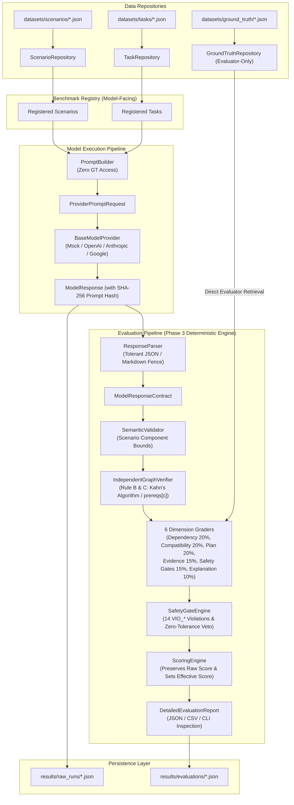

# PHOENIX-EVAL: System Architecture

## 1. Architectural Philosophy

PHOENIX-EVAL is built upon three foundational engineering principles:

1. **Strict Epistemic Isolation:** Model-visible scenario data is strictly quarantined from evaluator-only hidden ground truth. Models must reason strictly from provided discovery evidence without access to ground truth answers.
2. **Deterministic Reproducibility:** Every prompt, response, evaluation result, and dataset artifact is hashed via SHA-256 and serialized with deterministic key ordering.
3. **Pluggable & Extensible Foundation:** Core contracts, benchmark registry, model providers, and grading evaluators are decoupled via abstract interfaces, allowing seamless expansion across future phases.

---

## 2. High-Level Architecture Diagram



---

## 3. Module Responsibilities

| Module | Location | Primary Responsibilities |
| :--- | :--- | :--- |
| **Core** | `src/phoenix_eval/core/` | Centralized `Settings` (Pydantic Settings), project path resolution (`ProjectPaths`), custom exceptions hierarchy (`PhoenixEvalError`), sensitive data redaction logging (`configure_logging`), and benchmark constants. |
| **Schemas** | `src/phoenix_eval/schemas/` | Type-safe Pydantic v2 data models: `CryptographicComponent`, `DependencyRelationship`, `EvidenceRecord`, `CompatibilityRecord`, `ScenarioModel`, `BenchmarkTask`, `ModelResponse`, `EvaluationResult`, and `ExperimentRecord`. |
| **Data Layer** | `src/phoenix_eval/data/` | Repositories (`ScenarioRepository`, `TaskRepository`, `GroundTruthRepository`, `ResultsRepository`), deterministic JSON/JSONL/CSV serialization, and NetworkX topological analysis. |
| **Synthetic Generator** | `src/phoenix_eval/generator/` | Phase 2 Procedural Generation Engine: domain blueprints, architectural tier modeling, constraint extraction, evidence & compatibility synthesis, deterministic ground truth derivation, adversarial paired cases, and metamorphic invariance verification. |
| **Benchmark Registry** | `src/phoenix_eval/benchmark/` | Dynamic discovery, batch registration, task filtering (by category/difficulty), and referential integrity validation across artifacts. Strictly excludes ground truth. |
| **Prompt Builder** | `src/phoenix_eval/benchmark/prompt_builder.py` | Constructs sanitized model prompts containing only permitted scenario evidence and task instructions. |
| **Providers** | `src/phoenix_eval/providers/` | Abstract contract `BaseModelProvider` and deterministic `MockModelProvider` capturing token accounting, latency, and error states. |
| **Evaluator Contract** | `src/phoenix_eval/evaluator/` | Abstract contract `BaseEvaluator`, `EvaluationResultBuilder`, and pipeline test harness `MockEvaluator`. |
| **Evaluation Engine** | `src/phoenix_eval/evaluation/` | Phase 3 Deterministic Evaluation Engine: `DeterministicEvaluator`, `ResponseParser`, `SemanticValidator`, `IndependentGraphVerifier`, 6 dimension graders, `SafetyGateEngine`, `ScoringEngine`, and `CalibrationRunner`. |
| **Utils** | `src/phoenix_eval/utils/` | SHA-256 chunked hashing, UUID resource identifier generation, and ISO 8601 UTC time helpers. |
| **CLI** | `src/phoenix_eval/main.py` | Command-line interface providing configuration validation, project inspection, task listing, and scenario topological diagnostics. |

---

## 4. Ground Truth Isolation & Architectural Boundary

A common failure in benchmark systems is **evaluator data contamination**—where model prompting harnesses inadvertently load, serialize, or leak ground truth answers into evaluation prompts.

PHOENIX-EVAL enforces strict architectural isolation:

1. **Physical Directory Isolation:**
   - Model-visible scenarios live in `datasets/scenarios/`.
   - Benchmark tasks live in `datasets/tasks/`.
   - Hidden ground truth resides exclusively in `datasets/ground_truth/`.

2. **Registry Segregation:**
   - `BenchmarkRegistry` manages only `ScenarioModel` and `BenchmarkTask` instances.
   - It possesses **zero ground truth storage, zero ground truth retrieval methods, and zero ground truth loading routines**.
   - Model execution runners interacting with `BenchmarkRegistry` cannot query or inspect ground truth through the registry.

3. **Prompt Construction Protection:**
   - `PromptBuilder.build_model_prompt(task, scenario)` accepts strictly `(task, scenario)`. It accepts no ground truth objects or repositories.
   - It formats only observable evidence, component inventories, and task instructions.
   - `task.to_model_dict()` explicitly strips `ground_truth_reference` during model payload export.

4. **Standalone Evaluator Retrieval:**
   - Ground truth is retrieved solely by `BaseEvaluator` subclasses querying `GroundTruthRepository` directly at grading time.

### Realistic Security Boundary Limitations
This isolation is an **application-level architectural segregation of responsibilities** designed to prevent prompt contamination, accidental leakage, and test harness bleed. Because all components currently run in the same Python process without OS-level sandboxing, it is **not** an adversarial security boundary against malicious Python code executing inside the same runtime.

---

## 5. Topological Graph Representation

Every enterprise architecture scenario can be converted into a directed graph via `ScenarioModel.to_networkx_graph()`:

- **Nodes:** Represent `CryptographicComponent` entities with roles (e.g. `TLS_TERMINATION`, `KEY_STORAGE`), current algorithms, and technology stacks.
- **Edges:** Represent directed `DependencyRelationship` links with explicit semantics (`CALLS`, `ENCRYPTS_WITH`, `SHARES_KEY_WITH`, `HARDWARE_DEPENDENCY`).

The graph analysis utility `analyze_scenario_graph()` performs:
- **Cycle Detection:** Identifies non-DAG feedback loops that prevent simple topological sorting.
- **Root & Leaf Analysis:** Pinpoints external ingress proxies (roots) and leaf storage sinks.
- **Blocker Identification:** Detects components whose compatibility is `UNSUPPORTED` or `UNKNOWN` that have dependent callers.

---

## 6. Provider and Evaluator Extension Architecture

### Provider Contract (`providers/base.py`)
```python
class BaseModelProvider(abc.ABC):
    @abc.abstractmethod
    def generate_response(self, request: ProviderPromptRequest) -> ModelResponse:
        pass
```
*Extension Point:* In Phase 2, concrete providers will implement this contract for:
- `OpenAIProvider` (GPT-4o, o1, o3)
- `AnthropicProvider` (Claude 3.5 Sonnet, Claude 3 Opus)
- `GoogleProvider` (Gemini 1.5 Pro, Gemini 2.0)
- `VLLMProvider` (Llama-3, DeepSeek-R1, Mistral)

### Evaluator Contract (`evaluator/base.py`)
```python
class BaseEvaluator(abc.ABC):
    @abc.abstractmethod
    def evaluate(
        self,
        task: BenchmarkTask,
        response: ModelResponse,
        ground_truth: dict[str, Any],
    ) -> EvaluationResult:
        pass
```
*Implemented in Phase 3:* `DeterministicEvaluator` in `phoenix_eval.evaluation` implements this contract, grading model responses via pure Python mathematical and topological constraint checking.

---

## 7. Phase 2 Synthetic Generation Engine Architecture

The procedural synthesis subsystem (`phoenix_eval.generator`) produces scalable, mathematically consistent benchmark tasks without relying on LLM generation:

```
┌────────────────────────────────────────────────────────┐
│               GenerationPipeline Workflow              │
│                                                        │
│  GenerationConfig (Domain, Complexity, Seed)           │
│                       │                                │
│                       ▼                                │
│  SeedManager ──> ComponentGenerator (Blueprints)       │
│                       │                                │
│                       ▼                                │
│                 DependencyGenerator (Tiers & Edges)    │
│                       │                                │
│                       ▼                                │
│                 EvidenceGenerator & Compatibility      │
│                       │                                │
│                       ▼                                │
│                 Constraint Analysis (NetworkX DAG/G^R) │
│                       │                                │
│                       ▼                                │
│                 GroundTruthGenerator (Deterministic)   │
│                       │                                │
│                       ▼                                │
│  ┌────────────────────┴────────────────────┐           │
│  │                                         │           │
│  ▼                                         ▼           │
│  PairedCaseGenerator             MetamorphicEngine     │
│  (Minimal 1-Fact Divergence)     (MR1 - MR6 Invariants)│
│  │                               │                     │
│  ▼                               ▼                     │
│  paired_cases.json               metamorphic_results   │
│                                                        │
│  └────────────────────┬────────────────────┘           │
│                       │                                │
│                       ▼                                │
│  Artifact Hashing (SHA-256) & Manifest Generation      │
└────────────────────────────────────────────────────────┘
```

### Core Invariants Maintained by the Generator:
1. **Edge Direction**: $(u, v) \in E \iff u$ depends on $v$.
2. **Deterministic PRNG**: Every sub-module uses seeds branched from `SeedManager`.
3. **Graph Soundness**: Zero self-loops and zero dangling references in generated DAGs.
4. **Epistemic Consistency**: Ground truth blockers match explicit compatibility status values (`UNSUPPORTED` or `UNKNOWN`).
5. **Manifest Traceability**: Every generated run produces a signed `generation_manifest_<id>.json` containing exact file hashes for all outputs.

---

## 8. Phase 3 Deterministic Evaluation & Safety Gate Architecture

The Phase 3 evaluation engine (`phoenix_eval.evaluation`) operates as an independent, deterministic grading subsystem:

```
┌────────────────────────────────────────────────────────┐
│             Deterministic Evaluation Flow              │
│                                                        │
│  ModelResponse (Raw Text / JSON / Markdown)            │
│                       │                                │
│                       ▼                                │
│  ResponseParser (Extracts JSON & Handles Cutoffs)      │
│                       │                                │
│                       ▼                                │
│  ModelResponseContract (Pydantic v2 Schema)            │
│                       │                                │
│                       ▼                                │
│  SemanticValidator (Bounds & Contradiction Checking)   │
│                       │                                │
│                       ▼                                │
│  IndependentGraphVerifier (Rule B & C: Kahn's DAG)     │
│                       │                                │
│                       ▼                                │
│  6 Dimension Graders (Dependency, Compatibility,       │
│    Plan Correctness, Evidence, Safety Gates, Explain)  │
│                       │                                │
│                       ▼                                │
│  SafetyGateEngine (VIO_* Catalog & Critical Veto)      │
│                       │                                │
│                       ▼                                │
│  ScoringEngine (Raw Weighted Score vs Effective Score) │
│                       │                                │
│                       ▼                                │
│  DetailedEvaluationReport (Persisted to results/eval)  │
└────────────────────────────────────────────────────────┘
```

### Core Invariants Maintained by the Evaluator:
1. **Zero LLM Judges**: Evaluator is 100% deterministic Python logic.
2. **Evaluator Independence (Rule B)**: Graph verification does not import or invoke generator constraint functions.
3. **No Canonical Wave Bias (Rule C)**: Any causally valid topological sort that satisfies $p \in \text{prereqs}[c] \implies \text{wave}(p) < \text{wave}(c)$ receives 100% credit.
4. **Epistemic Inversion Block (Rule D)**: Assuming `UNKNOWN` is `SUPPORTED` triggers `VIO_UNKNOWN_ASSUMED_SUPPORTED` and an effective score of `0.0`.
5. **Verification Gate Enforcement (Rule E)**: Failed or missing mandatory tests block `MIGRATION_READY` via `VIO_FAILED_TEST_IGNORED`.
6. **Dual-Score Preservation**: Evaluator retains the continuous raw weighted score ($0-100$) for research telemetry while enforcing a zero effective score upon safety gate veto.


