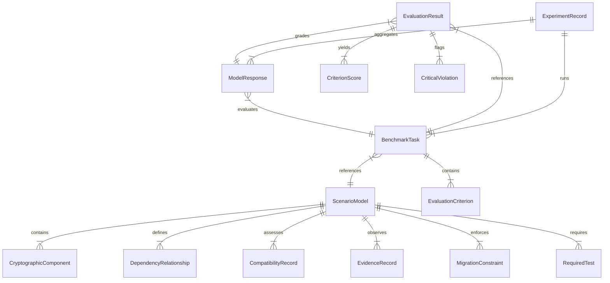

# PHOENIX-EVAL: Data Contracts Specification

All entities in PHOENIX-EVAL are implemented as **Pydantic v2** models with frozen configurations (`frozen=True`) and strict field validation (`extra="forbid"`) to guarantee data integrity.

---

## 1. Entity-Relationship Diagram

---

## 2. Core Data Models

### A. Cryptographic Component (`CryptographicComponent`)
Represents an enterprise node within the cryptographic boundary.

| Field | Type | Description |
| :--- | :--- | :--- |
| `component_id` | `str` | Valid identifier matching `^[a-zA-Z0-9][a-zA-Z0-9_\-\.]{1,127}$` (e.g., `comp-auth-svc-01`). |
| `component_name` | `str` | Human-readable name. |
| `component_type` | `ComponentType` | Enum: `APPLICATION`, `MICROSERVICE`, `SERVICE`, `DATABASE`, `API_GATEWAY`, `REVERSE_PROXY`, `LOAD_BALANCER`, `HARDWARE_SECURITY_MODULE`, `CERTIFICATE_AUTHORITY`, `KEY_MANAGEMENT_SERVICE`, `CLIENT_SDK`, `MESSAGE_BROKER`, `THIRD_PARTY_SERVICE`. |
| `cryptographic_role` | `CryptographicRole` | Enum: `TLS_TERMINATION`, `DATA_ENCRYPTION_AT_REST`, `DATA_ENCRYPTION_IN_TRANSIT`, `DIGITAL_SIGNATURE`, `KEY_EXCHANGE`, `KEY_GENERATION`, `KEY_STORAGE`, `AUTHENTICATION_TOKEN`, `CERTIFICATE_ISSUANCE`, `HASHING_INTEGRITY`, `PASSWORD_HASHING`. |
| `description` | `str` | Technical description of the component. |
| `technology` | `str` | Implementation runtime and library versions (e.g., `Java 17 / BouncyCastle 1.76`). |
| `current_algorithms` | `list[str]` | Active cryptographic algorithms (e.g., `["RSA-2048", "AES-256-GCM"]`). |
| `evidence_references` | `list[str]` | IDs of `EvidenceRecord`s backing this component's configuration. |
| `metadata` | `dict[str, Any]` | Auxiliary attributes (tier, owner, network zone). |

---

### B. Dependency Relationship (`DependencyRelationship`)
Represents a directed cryptographic interaction between two components.

| Field | Type | Description |
| :--- | :--- | :--- |
| `edge_id` | `str` | Unique edge identifier (e.g., `edge-auth-to-hsm-01`). |
| `source_component_id` | `str` | Consumer/caller component ID. |
| `target_component_id` | `str` | Provider/dependency component ID. |
| `relationship_type` | `RelationshipType` | Enum: `CALLS`, `ENCRYPTS_WITH`, `STORES_DATA_IN`, `SHARES_KEY_WITH`, `VERIFIES_SIGNATURE_FROM`, `CERTIFICATE_ISSUED_BY`, `USES_LIBRARY`, `WRAPS_SERVICE`, `HARDWARE_DEPENDENCY`, `EXCHANGES_KEYS_WITH`. |
| `evidence_references` | `list[str]` | Evidence IDs backing this edge. |
| `confidence` | `float` | Confidence score between `0.0` and `1.0`. |
| `description` | `str` | Contextual interaction notes. |
| `is_bidirectional` | `bool` | Whether interaction is strictly mutual. |
| `criticality` | `DependencyCriticality` | Enum: `LOW`, `MEDIUM`, `HIGH`, `CRITICAL`. |

*Validation Rule:* `source_component_id` must not equal `target_component_id` (self-referential loops are rejected).

---

### C. Evidence Record (`EvidenceRecord`)
Represents a discovered technical fact from security scanners, telemetry, or audits.

| Field | Type | Description |
| :--- | :--- | :--- |
| `evidence_id` | `str` | Unique identifier (e.g., `evid-tls-scan-01`). |
| `evidence_type` | `EvidenceType` | Enum: `STATIC_CODE_ANALYSIS`, `NETWORK_TRAFFIC_CAPTURE`, `CONFIGURATION_AUDIT`, `SBOM_INSPECTION`, `CIPHER_SCAN`, `CERTIFICATE_INSPECTION`, `HARDWARE_ATTESTATION`, `RUNTIME_TELEMETRY`, `MANUAL_ATTESTATION`. |
| `source` | `str` | Tool or human source that produced the evidence. |
| `description` | `str` | Detailed narrative of observation. |
| `observed_value` | `Any` | Discovered value (e.g., `OpenSSL 1.1.1w`). |
| `confidence` | `float` | Assessment confidence (`0.0` to `1.0`). |
| `timestamp` | `datetime` | UTC timestamp of observation. |
| `provenance` | `str` | Scan session ID, commit hash, or audit run ID. |
| `verification_status` | `VerificationStatus` | Enum: `VERIFIED`, `INFERRED`, `UNVERIFIED`, `CONFLICTING`, `DISPROVEN`, `ASSUMED`. |
| `evidence_category` | `EvidenceCategory` | Epistemic status: `OBSERVED`, `INFERRED`, `ASSUMPTION`. |

---

### D. Compatibility Record (`CompatibilityRecord`)
Represents an assessed compatibility state for a proposed cryptographic upgrade target.

| Field | Type | Description |
| :--- | :--- | :--- |
| `component_id` | `str` | Component ID under evaluation. |
| `proposed_target` | `str` | Target standard (e.g., `ML-KEM-768`, `TLS_1_3`, `ML-DSA-65`). |
| `status` | `CompatibilityStatus` | Enum: `SUPPORTED`, `UNSUPPORTED`, `UNKNOWN`. |
| `evidence_references` | `list[str]` | Supporting evidence IDs. |
| `reason` | `str` | Technical explanation of compatibility or reason for limitation. |
| `assessment_source` | `str` | Origin of assessment (e.g., vendor specification, test harness). |

*Critical Semantic Invariant:*
- `UNKNOWN` must never be treated as `SUPPORTED`.
- `is_safe_to_migrate` returns `True` **only** if status is explicitly `SUPPORTED`.
- If status is `UNKNOWN`, referencing evidence claiming "verified support" raises a validation error.

---

### E. Scenario Model (`ScenarioModel`)
A complete enterprise architectural environment containing components, dependencies, evidence, compatibility, constraints, and tests.

- `scenario_id`: `str`
- `scenario_name`: `str`
- `description`: `str`
- `system_components`: `list[CryptographicComponent]`
- `dependencies`: `list[DependencyRelationship]`
- `compatibility_records`: `list[CompatibilityRecord]`
- `evidence_records`: `list[EvidenceRecord]`
- `migration_constraints`: `list[MigrationConstraint]`
- `required_tests`: `list[RequiredTest]`
- `metadata`: `MetadataModel`

*Methods:*
- `to_networkx_graph() -> nx.DiGraph`: Converts components and dependencies into a directed NetworkX graph.
- `validate_integrity()`: Cross-checks that all dependency edges, evidence references, constraints, and tests reference existing component IDs without duplication.

---

### F. Benchmark Task (`BenchmarkTask`)
A standardized challenge presented to an AI model.

- `task_id`: `str`
- `task_name`: `str`
- `task_family`: `Optional[str]` (T01 through T10)
- `task_category`: `TaskCategory` (`DEPENDENCY_DISCOVERY`, `COMPATIBILITY_ASSESSMENT`, `MIGRATION_SEQUENCING`, `BLOCKER_IDENTIFICATION`, `EVIDENCE_VERIFICATION`, `RISK_ASSESSMENT`)
- `difficulty`: `DifficultyLevel` (`INTRODUCTORY`, `INTERMEDIATE`, `ADVANCED`, `EXPERT`)
- `description`: `str`
- `scenario_reference`: `str` (Points to scenario)
- `task_instructions`: `str` (Prompt instructions presented to model)
- `expected_output_schema`: `dict[str, Any]` (JSON Schema)
- `evaluation_criteria`: `list[EvaluationCriterion]`
- `ground_truth_reference`: `str` (Evaluator-only ground truth artifact ID)
- `tags`: `list[str]`
- `version`: `str`

*Methods:*
- `to_model_dict() -> dict[str, Any]`: Exports a sanitized task payload for model prompting and serialization, strictly omitting `ground_truth_reference`.

---

### G. Model Response (`ModelResponse`)
Captures raw model output, execution telemetry, and prompt hash.

- `response_id`: `str`
- `task_id`: `str`
- `model_provider`: `str` (e.g., `openai`, `anthropic`, `mock`)
- `model_identifier`: `str` (e.g., `gpt-4o`, `claude-3-5-sonnet`, `mock-v1`)
- `model_version`: `str`
- `raw_response`: `str`
- `parsed_response`: `Optional[dict[str, Any]]`
- `execution_status`: `ExecutionStatus` (`PENDING`, `RUNNING`, `COMPLETED`, `FAILED`, `TIMED_OUT`, `REFUSED`)
- `token_usage`: `Optional[TokenUsage]` (`prompt_tokens`, `completion_tokens`, `total_tokens`, `estimated_cost_usd`)
- `execution_duration`: `float` (seconds)
- `timestamp`: `datetime` (UTC)
- `prompt_hash`: `str` (SHA-256)

---

### H. Evaluation Result (`EvaluationResult`)
Structured outcome produced by the benchmark evaluator.

- `evaluation_id`: `str`
- `task_id`: `str`
- `response_id`: `str`
- `criterion_scores`: `list[CriterionScore]`
- `raw_score`: `float` (`0.0` to `100.0`)
- `safety_gate_status`: `SafetyGateStatus` (`PASSED`, `FAILED`, `BYPASSED_VIOLATION`, `INDETERMINATE`)
- `critical_violations`: `list[CriticalViolation]`
- `false_positive_count`: `int`
- `final_status`: `Literal["PASSED", "FAILED", "BLOCKED_BY_SAFETY_GATE", "INCOMPLETE"]`
- `evaluation_metadata`: `dict[str, Any]`

*Safety Gate Policy:* If `critical_violations` contains one or more items, `raw_score` is immediately zeroed out and `final_status` becomes `"BLOCKED_BY_SAFETY_GATE"`.

---

### I. Experiment Record (`ExperimentRecord`)
Aggregates a multi-model benchmark campaign.

- `experiment_id`: `str`
- `experiment_name`: `str`
- `selected_models`: `list[str]`
- `selected_tasks`: `list[str]`
- `number_of_trials`: `int`
- `configuration`: `dict[str, Any]`
- `start_time`: `datetime`
- `completion_time`: `Optional[datetime]`
- `execution_status`: `ExecutionStatus`
- `summary_metrics`: `Optional[dict[str, Any]]`
