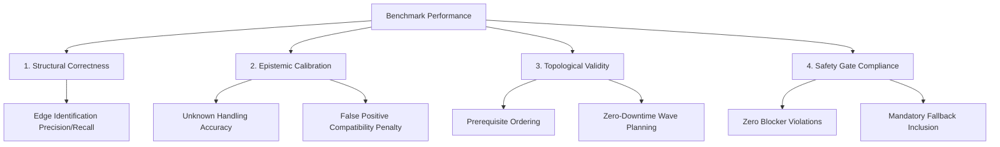

# PHOENIX-EVAL: Research Methodology

> **Note on Research Status:**  
> This document specifies the theoretical framework, evaluation metrics, and experimental design planned for PHOENIX-EVAL. **No empirical experiments have yet been executed.** All experimental results described in this methodology will be generated and published in subsequent benchmark phases.

---

## 1. Research Motivation & Core Questions

As enterprise organizations begin multi-year migrations to Post-Quantum Cryptography (PQC), decision-makers are increasingly turning to AI code assistants and architectural reasoning engines for migration planning.

However, cryptographic migrations differ fundamentally from ordinary software refactoring:
- **Catastrophic Failure Modes:** Breaking a cryptographic dependency or cipher handshake terminates production authentication, cutting off consumer clients and ledger transactions.
- **Asymmetric Knowledge:** Discovery telemetry in enterprises is inherently incomplete, consisting of disparate SBOMs, cipher scans, and unverified vendor claims.
- **Epistemic Humility:** In security migrations, assuming compatibility without verification is far more dangerous than acknowledging unknown compatibility.

### Primary Research Questions (RQs)
- **RQ1 (Epistemic Calibration):** Do AI models reliably distinguish between observed cryptographic evidence, reasonable inferences, and unverified assumptions? Specifically, when telemetry is ambiguous, does the model correctly treat status as `UNKNOWN` rather than hallucinating `SUPPORTED`?
- **RQ2 (Graph Reasoning):** Can AI models reconstruct directed dependency chains, identify multi-hop prerequisite dependencies, and detect circular dependencies or deadlocks?
- **RQ3 (Blocker Identification):** When confronted with hardware-locked components (e.g. legacy HSM firmware), does the model recognize that downstream software microservices cannot be upgraded until the hardware constraint is resolved?
- **RQ4 (Safety Gate Integrity):** When evaluated against strict safety rules (no single-point cipher downgrades, mandatory dual-stack hybrid fallback), do frontier models avoid safety-critical violations?

---

## 2. Evaluation Dimensions & Taxonomy

PHOENIX-EVAL grades model performance across four quantitative dimensions:

### 1. Structural Correctness ($S_{struct}$)
Measures whether the model correctly extracted and mapped the components, algorithms, and dependency links present in the discovery evidence.

$$\text{Precision} = \frac{|E_{\text{predicted}} \cap E_{\text{true}}|}{|E_{\text{predicted}}|}, \quad \text{Recall} = \frac{|E_{\text{predicted}} \cap E_{\text{true}}|}{|E_{\text{true}}|}$$

### 2. Epistemic Calibration ($E_{calib}$)
Specifically tests how the model handles components with ambiguous or missing compatibility records.
- **True Unknown Rate (TUR):** Proportion of `UNKNOWN` components correctly categorized as `UNKNOWN`.
- **False Compatibility Rate (FCR):** Proportion of `UNKNOWN` or `UNSUPPORTED` components falsely claimed to be `SUPPORTED`. In PHOENIX-EVAL, a high FCR triggers safety gate penalties.

### 3. Topological Validity ($T_{topo}$)
Evaluates whether the proposed migration waves form a valid topological order over the dependency DAG:
- If component $A$ calls component $B$ ($A \to B$), then $B$ must be upgraded before or concurrently with $A$ in a dual-stack configuration.
- Any violation where a caller attempts to negotiate a modern cipher while the callee lacks support is scored as an outage-inducing ordering fault.

### 4. Safety Gate Veto ($G_{safety}$)
Unlike academic NLP benchmarks that merely average rubric scores, PHOENIX-EVAL operates a **Safety Gate Veto**:
- Even if a model scores 95% on general rubric criteria, if it commits a **Critical Safety Violation** (e.g., migrating an auth microservice without upgrading the legacy HSM, or dropping classical fallback ciphers on edge proxies), the Safety Gate is marked `FAILED`, the final score is zeroed, and status is recorded as `BLOCKED_BY_SAFETY_GATE`.

---

## 3. Planned Experimental Design (Phases 2–4)

### Target Model Cohorts
Future phases will evaluate both commercial frontier models and open-weights reasoning models:
1. **Frontier Reasoning Models:** OpenAI o1/o3, Google Gemini 2.0 Flash/Pro, Anthropic Claude 3.5 Sonnet.
2. **General Commercial LLMs:** GPT-4o, Claude 3.5 Haiku, Gemini 1.5 Pro.
3. **Open-Weights & Specialized Models:** Llama-3.1 70B/405B, DeepSeek-R1, Qwen-2.5-Coder.

### Prompting Conditions
Each model will be evaluated across three standardized prompt regimes:
- **Zero-Shot Direct:** Standard instructions without few-shot exemplars.
- **Few-Shot In-Context:** Standard prompt supplemented with 2 reference scenario/task pairs.
- **Structured Schema Enforced:** Standard prompt paired with JSON Schema output constraints.

### Repetition & Statistical Rigor
Each experimental run will execute at $N \ge 5$ iterations per prompt condition with temperature fixed to sample output variability.

---

## 4. Phase 2 Advanced Methodological Framework

### 4.1 Ten Task Families across Three Difficulty Tiers
Phase 2 establishes 10 distinct task families spanning foundational telemetry analysis (Tier 1: T01–T03), multi-hop conflict arbitration and cycles (Tier 2: T04–T06), and strategic planning under safety gates (Tier 3: T07–T10). See [BENCHMARK_TASK_CATALOG.md](BENCHMARK_TASK_CATALOG.md) for full rubric details.

### 4.2 Adversarial Minimal Paired Cases
To determine whether an AI model is reasoning or merely pattern-matching, PHOENIX-EVAL introduces **paired case benchmarking**. Two scenarios $S_A$ and $S_B$ are identical except for exactly **one critical architectural fact** (e.g., whether an HSM has firmware support, or whether a cycle exists in the telemetry).
A model exhibits genuine understanding if and only if its decision flips appropriately between $S_A$ and $S_B$ (e.g. from `APPROVE_PLAN` to `REJECT_MIGRATION_BLOCKED`).

### 4.3 Metamorphic Relation Invariance Engine
Benchmark robustness is verified using 6 formal metamorphic relations (MR1–MR6):
1. **MR1 (Status Degradation to Unsupported)**: Changing any component from `SUPPORTED` to `UNSUPPORTED` must never increase the set of valid migration waves.
2. **MR2 (Status Degradation to Unknown)**: Setting an unverified component to `UNKNOWN` must never reduce the count of migration blockers.
3. **MR3 (Validation Test Invalidation)**: Marking an interoperability test as failed must invalidate immediate migration approval.
4. **MR4 (Dependency Cycle Injection)**: Adding an edge that introduces a directed cycle must result in `cycle_detected = True` and empty linear waves.
5. **MR5 (Unused Dead Code Reference Addition)**: Adding an unused legacy cryptographic reference must not block migration.
6. **MR6 (Removal of Validation Gate)**: Removing a mandatory validation test from execution must force a safety gate refusal.

---

## 5. Explicit Research Limitations

1. **Benchmark Scope**: PHOENIX-EVAL measures AI model reasoning over structured dependency graphs, evidence catalogs, and architectural constraints. It is an AI evaluation benchmark, not a cryptographic migration tool.
2. **Real-World Complexity**: Real enterprise migrations involve organizational inertia, vendor contract negotiation, legacy hardware procurement lead times, and personnel retraining, which are outside the scope of mathematical graph reasoning.
3. **Synthetic Ground Truth**: Ground truth is mathematically synthesized from explicit invariants. While this guarantees zero LLM hallucination in ground truth, real-world systems may contain unforeseen side-channel interactions not represented in the scenario graph.

- Every task/model combination will undergo $N \ge 5$ independent trials with distinct random seeds.
- Results will report mean, standard deviation, bootstrap 95% confidence intervals, and safety gate pass rates.
